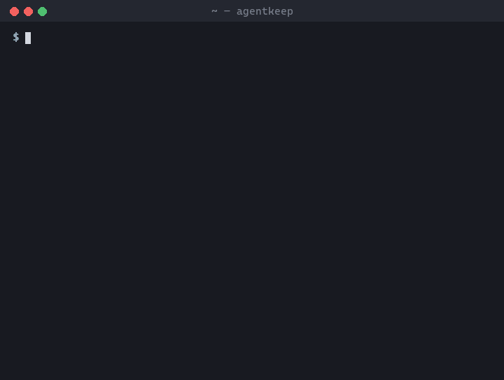

# agentkeep

**An update wiped your MCP servers again? Put them back in one command.**

Claude Code, Codex and Gemini CLI rewrite their own settings files. Sometimes
an update, a migration or a second tool drops your hooks, your MCP servers,
your `env` block or your `model_providers`, and you find out mid-task.
agentkeep snapshots the settings that matter, tells you exactly what went
missing, and puts it back without touching anything else.

<p align="center"></p>

## Use

```sh
npx agentkeep snapshot     # once, while everything works
npx agentkeep check        # after an update, or any time
npx agentkeep restore      # put back what was removed or emptied
npx agentkeep watch        # or keep it running and let it restore by itself
```

| Command | What it does |
|---|---|
| `snapshot` | Saves the protected settings and a copy of each file. Refuses to save over a good snapshot if settings have gone missing since (`--force` if you removed them on purpose). |
| `check` | Lists settings that were **removed**, **emptied** or **changed** since the snapshot. Exits `2` if anything was lost, so it works in scripts. |
| `restore` | Backs each file up, then puts back removed and emptied settings. Values you changed on purpose are left alone unless you pass `--changed`. `--dry-run` shows what it would do. |
| `watch` | Watches the files and restores lost settings within seconds. Settings you add are snapshotted as you go. If something keeps wiping a file, it stops after one try and tells you, instead of fighting it. |

Options: `--tool claude|codex|gemini` (repeatable), `--json`.

## What is protected

| Tool | File | Settings |
|---|---|---|
| Claude Code | `~/.claude/settings.json` | `model`, `env.*`, `hooks.*`, `permissions.*`, `statusLine`, `enabledPlugins.*`, marketplaces, `mcpServers.*`, `apiKeyHelper`, `outputStyle` |
| Claude Code | `~/.claude.json` | user-scope `mcpServers.*` only (the rest of this file is the tool's own state) |
| Codex | `~/.codex/config.toml` | `model`, `model_provider`, `openai_base_url`, `approval_policy`, `sandbox_mode`, `notify`, `model_providers.*`, `mcp_servers.*`, `profiles.*`, `features.*`, `hooks.*`, `plugins.*` |
| Gemini CLI | `~/.gemini/settings.json` | `mcpServers.*`, `hooks.*`, `model.*`, `security.*`, `tools.*`, `context.*`, `selectedAuthType` |

`x.*` means each child is tracked on its own, so one lost MCP server is put
back without touching the others. Counters, caches and UI state the tools
write themselves are ignored, so `check` stays quiet unless something real
changed. `CLAUDE_CONFIG_DIR` and `CODEX_HOME` are respected.

## Safety

- **Backup before every write**, in `~/.agentkeep/backups/`.
- **Formatting is kept.** JSON keeps its indentation, line endings and key
  order, and a restored key goes back where it was. Settings missing from TOML
  are added as text, so your comments stay (a restored table goes at the end of
  the file); if a value has to be replaced in TOML, the file is rewritten and
  agentkeep says so.
- **Broken files are never overwritten.** A file that doesn't parse, or JSON
  with comments, is reported and skipped.
- **Every write is checked.** After restoring, the file is read back; if the
  settings aren't there, the original is put back.
- **Secrets stay out of the terminal.** Values under keys like `token`,
  `api_key` or `auth` print as `•••••• (32 chars)`.
- The snapshot holds copies of your settings files, including any API keys in
  them. It lives in `~/.agentkeep/` with owner-only permissions on
  macOS/Linux. Don't commit or share that folder.

## Settings

| Variable | Default |
|---|---|
| `AGENTKEEP_DIR` | `~/.agentkeep` |
| `AGENTKEEP_HOME` | your home directory (where the tools' files are looked for) |
| `NO_COLOR` | set to turn colors off |
| `FORCE_COLOR` | set to keep colors when output is piped (`0` turns them off) |

Node.js 18 or newer. macOS, Linux and Windows.

## License

MIT
